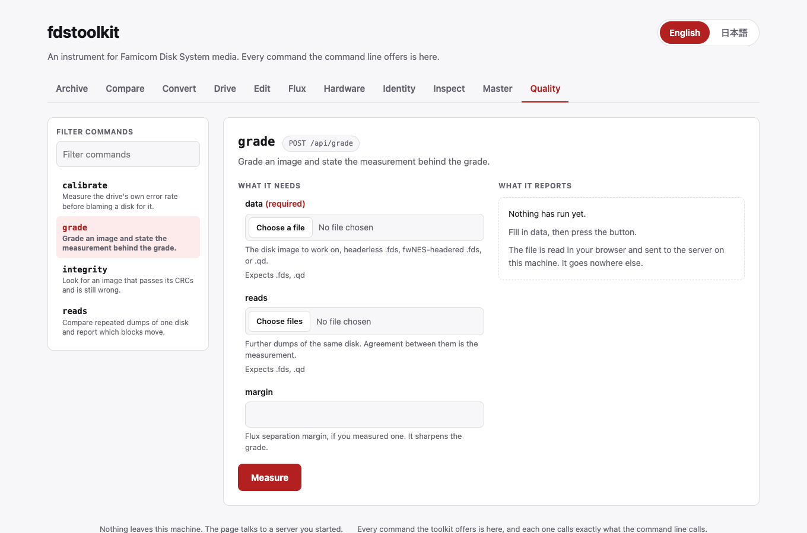

<div align="center">

# fdstoolkit

<strong>ディスクカードを読み取り、読み取れたものを評価し、任天堂が書いた内容を復元し、そしてもう一度書き込む。</strong>

[English](README.md) | 日本語 | [简体中文](README.zh-Hans.md) | [繁體中文 (香港)](README.zh-HK.md)

[](https://github.com/gufranco/fdstoolkit/actions/workflows/ci.yml)
[](https://github.com/gufranco/fdstoolkit/releases/latest)
[](https://github.com/gufranco/fdstoolkit/actions/workflows/ci.yml)
[](https://scorecard.dev/viewer/?uri=github.com/gufranco/fdstoolkit)
[](LICENSE)

<p align="center">
  <a href="#使い方">使い方</a> |
  <a href="#インストール">インストール</a> |
  <a href="#コマンド">コマンド</a> |
  <a href="#手順">手順</a> |
  <a href="#ウェブインターフェース">ウェブインターフェース</a> |
  <a href="REFERENCE.ja.md">リファレンス</a>
</p>

</div>

コマンドは 26 個で、`doctor` 以外はローカルの Web ページからも使えます。Python のテスト 1,817 件とページのテスト 142 件で、行と分岐の 100 パーセントを網羅しています。

---

ファミコン ディスクシステムのディスクカードを扱うためのコマンドラインツールです。読み取り、品質の測定、再構成、書き戻し、そしてそれらを行うドライブ自体の調整までを対象とします。

これは製品ではなく計測器です。ディスク情報ブロックが何かを理解しており、ドライブを開けて半固定抵抗を回すことを厭わず、判定だけでなく測定値そのものを見たい人を想定しています。報告を行うコマンドはすべて `--json` を受け付けます。異常がなければ終了コード 0、あれば 1 を返すため、シェルスクリプトに組み込めます。

## 使い方

イメージを扱う処理はすべてドライブなしで動きます。キャリブレーション用ディスクを作り、その内容を表示し、検査し、識別します。

```bash
fdstoolkit blank --calibration -o calibration.fds
fdstoolkit info calibration.fds
fdstoolkit verify calibration.fds
fdstoolkit hash calibration.fds --profile release
```

```
wrote calibration.fds (131000 bytes)
write it only on a drive you trust, with write --calibration --trusted-drive, which lists every adjustment that drive needs first
calibration.fds: fds container, 2 side(s), 131000 bytes
  side 0: CAL files=6 hidden=0 rewrites=0
  side 1: CAL files=6 hidden=0 rewrites=0
ok
size      131000
crc32     a53e8978
md5       4a73ce2d23e89c68b1b09c280d5eaa11
sha1      9311d8eff476053549e62cff9035bf319998110f
sha256    e2a0bf3ff01a55ddacdbe4a5f62560dc76f12aac5cbf920f5a6f007275e32c02
canonical fdstoolkit:v1:release/v1:466fb0140c92458a0d5e48a08d6574fd0912d45263b1b53d985f348eafcbe0ce
ra md5    4a73ce2d23e89c68b1b09c280d5eaa11
```

`canonical` の行は、ディスクライターでどちらかが書き換えられた後でも、同じ製品の 2 枚が共有するダイジェストです。FDSStick を接続すると、`dump`、`write`、`calibrate` で実際のディスクを扱えます。その順序は下の[手順](#手順)にまとめています。

## インストール

```bash
brew install gufranco/tap/fdstoolkit
```

formula は共有の formula 専用タップ [gufranco/homebrew-tap](https://github.com/gufranco/homebrew-tap) にあります。`brew install --HEAD gufranco/tap/fdstoolkit` は `main` ブランチを追跡します。

Homebrew がサポート対象のインストール経路であり、フォーミュラはすべてを含みます。ドライブが必要とする hidapi ライブラリも、ウェブインターフェースもです。追加で入れるものはなく、新規インストール直後に `doctor` がそれを検証します。

インストール状態と、到達できるハードウェアを確認します。

```bash
fdstoolkit doctor
```

```
fdstoolkit        3.0.0
python            3.14.10
platform          Darwin arm64
hardware support  hidapi is installed
fdsstick          1 device(s) connected, FDSStick, serial 0001, firmware 3.12
fdsstick access   the device opens for reading and writing
codec             a known disk round-trips to the same 65500 bytes, 2 blocks, 0 finding(s)
identity          2 blanks match their published digests
```

`doctor` はソフトウェアだけでなく接続経路全体を確認します。hidapi が入っているか、FDSStick が `16D0:0AAA` に接続されているか、デバイスが自己申告するメーカー名・製品名・シリアル・ファームウェアは何か、そして実際にオープンできるかを報告します。最後の項目は Linux で特に重要です。列挙はできるのに udev ルールがないためオープンできない、という状態が起こり得るからです。その場合 `doctor` はこの項目を失敗として扱い、書き込むべきルールを表示します。

## コマンド

各コマンドの引数、出力、根拠は [REFERENCE.ja.md](REFERENCE.ja.md) にあります。どのコマンドも `--help` で同じ説明を表示します。

- **検査**: [`info`](REFERENCE.ja.md#info), [`boot`](REFERENCE.ja.md#boot), [`hash`](REFERENCE.ja.md#hash), [`provenance`](REFERENCE.ja.md#provenance)
- **確認**: [`verify`](REFERENCE.ja.md#verify), [`grade`](REFERENCE.ja.md#grade), [`reads`](REFERENCE.ja.md#reads), [`log`](REFERENCE.ja.md#log), [`track`](REFERENCE.ja.md#track), [`triage`](REFERENCE.ja.md#triage), [`diff`](REFERENCE.ja.md#diff)
- **修復**: [`rebuild`](REFERENCE.ja.md#rebuild), [`set`](REFERENCE.ja.md#set), [`insert`](REFERENCE.ja.md#insert), [`extract`](REFERENCE.ja.md#extract), [`patch`](REFERENCE.ja.md#patch), [`splice`](REFERENCE.ja.md#splice), [`consensus`](REFERENCE.ja.md#consensus), [`save`](REFERENCE.ja.md#save)
- **コンテナ**: [`convert`](REFERENCE.ja.md#convert), [`blank`](REFERENCE.ja.md#blank), [`build`](REFERENCE.ja.md#build)
- **ハードウェア**: [`status`](REFERENCE.ja.md#status), [`doctor`](REFERENCE.ja.md#doctor), [`dump`](REFERENCE.ja.md#dump), [`rescue`](REFERENCE.ja.md#rescue), [`erase`](REFERENCE.ja.md#erase), [`write`](REFERENCE.ja.md#write), [`refresh`](REFERENCE.ja.md#refresh), [`save-backup`](REFERENCE.ja.md#save-backup), [`save-restore`](REFERENCE.ja.md#save-restore), [`duplicate`](REFERENCE.ja.md#duplicate), [`surface`](REFERENCE.ja.md#surface), [`calibrate`](REFERENCE.ja.md#calibrate), [`session`](REFERENCE.ja.md#session), [`web`](REFERENCE.ja.md#web)

## 手順

### ディスクを保存する

1 回の吸い出しは、ドライブが 1 度何を読んだかを示すだけです。2 回でようやく、同じものを 2 度読めたかが分かります。[dumping.guide](https://dumping.guide/other/nintendo/fds) の勧めどおり、1 回目の前と 2 回目の前にディスクを清掃してください。吸い出しの間に動いたほこりを、弱い面と取り違えないためです。

```bash
fdstoolkit dump -o pass1.fds --passes 3 --raw captures/
fdstoolkit dump -o pass2.fds
fdstoolkit reads pass1.fds pass2.fds
fdstoolkit reads --captures captures/
fdstoolkit grade pass1.fds --read pass2.fds --captures captures/
```

3 パスにすると、一式には各面の読み取りが 3 回そろいます。弱いブロックの一覧とパルス投票に必要なのはこれです。2 つの吸い出しが食い違う場合、`consensus` が多数決で統合し、決着しなかったブロックをすべて列挙します。`consensus pass1.fds pass2.fds --captures captures/` はパルス投票を投票者の 1 つとして加えます。一方の吸い出しで壊れているブロックが他方で正常なら、`splice` がそれを取り込みます。一式はイメージと一緒に保管してください。ディスクがどう読めたかを記録しているのはこれだけで、あとからディスクなしで投票し直せます。読み直さないと読めないディスクには `fdstoolkit refresh -o refreshed.fds --backup before.fds` を使います。すべてのブロックが確定したら、工場出荷時の配置で書き戻します。失敗し続けるディスクには `fdstoolkit rescue rescue-folder/ -o disk.fds` を使い、すべてのブロックが確定するまで別の日や別のドライブで実行し直します。各実行の読み取りは保存され、それまでの読み取りと一緒に投票します。

### ドライブを調整する。粗調整から微調整へ

1. 何よりも先にヘッドを清掃してください。汚れは媒体の不良として現れます。
2. 工場出荷のディスク、または信頼できるドライブで書き込んだキャリブレーション用ディスクを用意します。このドライブが書き込んだディスクは決して使いません。工場出荷のディスクのイメージがあれば計数はより正確になり、なくても `calibrate` は正しく読めた読み取りから各ブロックを学習します。
3. ベルトを交換した後は `calibrate head` を実行し、スピンドルハブ、次にヘッドをおよそ 45 度ずつ調整して、すべての読み取りが正しくなるまで続けます。
4. `calibrate speed` を実行し、指示どおりにモーターの速度を上げ下げして、正しく読めるまで続けます。
5. スティックは最後の 1 パーセントを見られないので、速度の仕上げは実機側のテストかストロボで行います。
6. さらに 2 枚の工場出荷のディスクで `calibrate head` を繰り返します。そのうえで、読み取りが難しいと分かっているディスクで確認します。コミュニティでは 39 ファイルを含む特定の面が使われており、チェックサムエラーなしに 39 個すべて読めれば合格です。
7. ドライブが正しく読めるようになったら、その工場出荷のディスクで `fdstoolkit session --reference factory.fds` を実行し、基準を記録します。以後のセッションは毎回同じコマンドで始めます。前回の確認よりそのディスクの読み取りが悪くなっていれば警告します。

### ドライブとディスクのどちらが原因かを判断する

1 枚のディスクではこの問いに答えられません。複数枚を読んで、どこで失敗したかを比べてください。どのディスクでも同じ場所で失敗するならドライブ、1 枚だけで起きるならそのディスク、ドライブが応答しなくなるならそのどちらでもありません。最後の場合の正しい対応は、別のディスクを入れて試すことではなく、中止することです。`fdstoolkit triage a/ b/ c/` は、同じドライブで各ディスクを `dump --raw` したキャプチャ一式からこの比較を行います。

### DupliFDS で作ったコピーの確認

[DupliFDS](https://github.com/ClusterM/duplifds) は本体の上でディスクをコピーし、書いた内容を読み返しません。そのため、コピーは元のディスクと比べるまで確かめられていない状態です。

1. 元のディスクをダンプします: `fdstoolkit dump -o source.fds`。
2. コピーを吸い出します: `fdstoolkit dump -o copy.fds`。
3. 両者を比べます: `fdstoolkit diff source.fds copy.fds --explain`。一致すれば、コピーはすべてのブロックを持っています。DupliFDS が途中で止まったコピーは、途中で止まったものとして報告され、元のファイルのうちいくつを持つかが示されます。DupliFDS は、それまでにコピーしたファイルだけを数えたファイル数を書くからです。
4. コピーを評価します: コピーをもう一度ダンプしたものと合わせて `fdstoolkit grade copy.fds --read copy2.fds` を実行すると、新しいディスクが安定して読めるかがわかります。`diff` が一致しただけでは、そこまではわかりません。

### 複数のコピーを作る

`fdstoolkit duplicate source.fds --count 5` は空のディスクを 1 枚ずつ求め、イメージを書き、コピーを読み戻して、コピーごとに 1 行を表示します。失敗したコピーは理由とともに数え、次のディスクへ進みます。配る前に、各コピーを別のドライブで読んでください。自分が書いたものを読み戻せても、そのドライブについては何も分かりません。

## ウェブインターフェース

```bash
fdstoolkit web
```

`web` はブラウザでページを開きます。`fdstoolkit web --no-open` はブラウザを開かずにサーバーだけを起動します。SSH 越しに使う場合はこちらです。ヘッドレス専用のコマンドはありません。本ツールはこの端末に接続されたハードウェアを操作するものであり、公開サービスになることはないからです。

<picture>
<source media="(prefers-color-scheme: dark)" srcset="assets/screenshots/grade-dark.png">

</picture>

既定では `127.0.0.1:8000` を待ち受けます。これはサービスではありません。`--host` を指定しない限り公開インターフェースでは待ち受けず、ページは外部リソースを一切読み込まないため、データがこの端末から出ることはありません。

ページが呼び出す経路と、それぞれが対応するコマンドの一覧は [REFERENCE.ja.md](REFERENCE.ja.md#ウェブインターフェース) にあります。

## このツールにできないこと

**ディスクシステムのフラックスキャプチャは存在しません。** Quick Disk はインデックス穴も標準的なステッピングも持たない 1 本の連続した渦巻きであり、KryoFlux や Greaseweazle はこの媒体を読むことができません。本ツールが読み込むのは FDSStick が生成するものだけです。

**パルスクラスからはドライブ速度の最後の 1 パーセントを測定できません。** 現在のファームウェアは機器の中で各パルスを 3 種類の長さのいずれかへ丸め、時間情報ではなくクラスを送ってくるので、小さな速度のずれではクラスが変わりません。`calibrate speed` は許容範囲の外にあるドライブを見つけ、仕上げは実機側のテストかストロボで行います。

**ヘッドの精密な位置合わせはパルスクラスからは測定できません。** 信号振幅かパルスのタイミングが必要ですが、ファームウェア 3.12 はどちらも送りません。`calibrate head` はブロックが読めたかどうかしか見ないので、位置が大きくずれたヘッドやハブは見つけられても、わずかに中心を外れただけのものは見つけられません。

**ベルトの不良とモーターの不良は切り分けられません。** プーリー比が必要ですが、信頼できる出典がその値を示していません。

## バージョン

リリースは [セマンティック バージョニング](https://semver.org/)に従い、修正や機能追加のたびに `main` から自動で公開されます。メジャーバージョンが上がるのはコマンドを削除または変更したときで、3.0.0 では `export` を削除しました。各バージョンの変更点は[リリースページ](https://github.com/gufranco/fdstoolkit/releases)にあります。

## サポート

| 用件 | 窓口 |
|:-----|:------|
| 正しく動かない | [不具合の報告](https://github.com/gufranco/fdstoolkit/issues/new?template=bug.yml) |
| 実機のドライブでの結果 | [ハードウェアの報告](https://github.com/gufranco/fdstoolkit/issues/new?template=hardware.yml) |
| セキュリティ上の問題かもしれないもの | [セキュリティポリシー](SECURITY.md) |
| 開発環境、テスト、リリース | [CONTRIBUTING.md](CONTRIBUTING.md) |

## ライセンス

MIT です。[LICENSE](LICENSE) を参照してください。

---

<div align="center">

ファミコン ディスクシステム / ディスクカード の保存、吸い出し、ディスク品質の測定、
ドライブの調整、ベルト交換、モーター回転数の調整、FDSStick。

English documentation: <a href="README.md">README.md</a>

</div>
