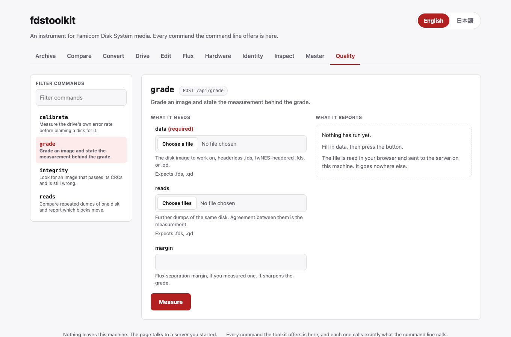

<div align="center">

# fdstoolkit

<strong>Read a Famicom Disk System disk, judge what came back, reconstruct what Nintendo wrote, and write it again.</strong>

English | [日本語](README.ja.md) | [简体中文](README.zh-Hans.md) | [繁體中文 (香港)](README.zh-HK.md)

[](https://github.com/gufranco/fdstoolkit/actions/workflows/ci.yml)
[](https://github.com/gufranco/fdstoolkit/releases/latest)
[](https://github.com/gufranco/fdstoolkit/actions/workflows/ci.yml)
[](https://scorecard.dev/viewer/?uri=github.com/gufranco/fdstoolkit)
[](LICENSE)

<p align="center">
  <a href="#usage">Usage</a> |
  <a href="#install">Install</a> |
  <a href="#commands">Commands</a> |
  <a href="#procedures">Procedures</a> |
  <a href="#web-interface">Web interface</a> |
  <a href="REFERENCE.md">Reference</a>
</p>

</div>

26 commands, all but `doctor` also on the local web page, covered by 1,817 Python tests and 142 page tests at 100 percent of lines and branches.

---

A command-line toolkit for Famicom Disk System media: reading it, judging it, reconstructing it, writing it back, and keeping the drive that does all of that in adjustment.

This is an instrument, not an application. It assumes you know what a disk information block is, that you are willing to open a drive and turn a trimmer, and that you would rather be told a measurement than a verdict. Every command that reports something accepts `--json`. Every command exits 0 when nothing failed and 1 when something did, so they compose in scripts.

## Usage

Everything that works on an image runs without a drive. Build the calibration disk, describe it, check it and identify it:

```bash
fdstoolkit blank --calibration -o calibration.fds
fdstoolkit info calibration.fds
fdstoolkit verify calibration.fds
fdstoolkit hash calibration.fds --profile release
```

```
wrote calibration.fds (131000 bytes)
write it only on a drive you trust, with write --calibration --trusted-drive, which lists every adjustment that drive needs first
calibration.fds: fds container, 2 side(s), 131000 bytes
  side 0: CAL files=6 hidden=0 rewrites=0
  side 1: CAL files=6 hidden=0 rewrites=0
ok
size      131000
crc32     a53e8978
md5       4a73ce2d23e89c68b1b09c280d5eaa11
sha1      9311d8eff476053549e62cff9035bf319998110f
sha256    e2a0bf3ff01a55ddacdbe4a5f62560dc76f12aac5cbf920f5a6f007275e32c02
canonical fdstoolkit:v1:release/v1:466fb0140c92458a0d5e48a08d6574fd0912d45263b1b53d985f348eafcbe0ce
ra md5    4a73ce2d23e89c68b1b09c280d5eaa11
```

The `canonical` line is the digest two copies of one release share after a Disk Writer kiosk rewrote either. With an FDSStick attached, `dump`, `write` and `calibrate` work on real disks; the [procedures](#procedures) below put them in order.

## Install

```bash
brew install gufranco/tap/fdstoolkit
```

The formula lives in [gufranco/homebrew-tap](https://github.com/gufranco/homebrew-tap), a shared formula-only tap. `brew install --HEAD gufranco/tap/fdstoolkit` tracks `main`.

Homebrew is the supported install path, and the formula carries everything: the
hidapi library the drive needs and the web interface. Nothing else has to be
installed, and `doctor` proves it on a fresh install.

Confirm the installation and what it can reach:

```bash
fdstoolkit doctor
```

```
fdstoolkit        3.0.0
python            3.14.10
platform          Darwin arm64
hardware support  hidapi is installed
fdsstick          1 device(s) connected, FDSStick, serial 0001, firmware 3.12
fdsstick access   the device opens for reading and writing
codec             a known disk round-trips to the same 65500 bytes, 2 blocks, 0 finding(s)
identity          2 blanks match their published digests
```

`doctor` checks the whole chain, not only the software. It reports whether hidapi is
installed, whether an FDSStick is attached at `16D0:0AAA`, its manufacturer, product,
serial and firmware as the device reports them, and whether it can actually be opened.
The last check matters most on Linux, where a device enumerates fine and still refuses to
open without a udev rule; `doctor` fails that check and prints the rule to install.

## Commands

Every command's options, output and the basis for each figure are in [REFERENCE.md](REFERENCE.md), and `--help` on any command prints its summary.

- **Inspect**: [`info`](REFERENCE.md#info), [`boot`](REFERENCE.md#boot), [`hash`](REFERENCE.md#hash), [`provenance`](REFERENCE.md#provenance)
- **Check**: [`verify`](REFERENCE.md#verify), [`grade`](REFERENCE.md#grade), [`reads`](REFERENCE.md#reads), [`log`](REFERENCE.md#log), [`track`](REFERENCE.md#track), [`triage`](REFERENCE.md#triage), [`diff`](REFERENCE.md#diff)
- **Repair**: [`rebuild`](REFERENCE.md#rebuild), [`set`](REFERENCE.md#set), [`insert`](REFERENCE.md#insert), [`extract`](REFERENCE.md#extract), [`patch`](REFERENCE.md#patch), [`splice`](REFERENCE.md#splice), [`consensus`](REFERENCE.md#consensus), [`save`](REFERENCE.md#save)
- **Container**: [`convert`](REFERENCE.md#convert), [`blank`](REFERENCE.md#blank), [`build`](REFERENCE.md#build)
- **Hardware**: [`status`](REFERENCE.md#status), [`doctor`](REFERENCE.md#doctor), [`dump`](REFERENCE.md#dump), [`rescue`](REFERENCE.md#rescue), [`erase`](REFERENCE.md#erase), [`write`](REFERENCE.md#write), [`refresh`](REFERENCE.md#refresh), [`save-backup`](REFERENCE.md#save-backup), [`save-restore`](REFERENCE.md#save-restore), [`duplicate`](REFERENCE.md#duplicate), [`surface`](REFERENCE.md#surface), [`calibrate`](REFERENCE.md#calibrate), [`session`](REFERENCE.md#session), [`web`](REFERENCE.md#web)

## Procedures

### Preserving a disk

One dump says what the drive read once. Two say whether it read the same thing twice. Clean the disk before the first dump and again before the second, as [dumping.guide](https://dumping.guide/other/nintendo/fds) advises, so dirt that moved between dumps is not taken for a weak surface.

```bash
fdstoolkit dump -o pass1.fds --passes 3 --raw captures/
fdstoolkit dump -o pass2.fds
fdstoolkit reads pass1.fds pass2.fds
fdstoolkit reads --captures captures/
fdstoolkit grade pass1.fds --read pass2.fds --captures captures/
```

Three passes give the bundle three reads of every side, which is what the weak-block map and the pulse vote need. If the two dumps disagree, `consensus` merges them by majority and names every block that did not settle, and `consensus pass1.fds pass2.fds --captures captures/` adds the pulse vote as one more voter. If one dump has a block another has good, `splice` takes it. Keep the bundle with the images: it is the only record of how the disk read, and it can be voted again later without the disk. A disk that reads only after re-reads gets `fdstoolkit refresh -o refreshed.fds --backup before.fds`, which writes it back as the factory laid it out once every block settles. A disk that keeps failing gets `fdstoolkit rescue rescue-folder/ -o disk.fds`, run again on later days or other drives until every block settles: each run's reads are kept and vote with the earlier ones.

### Calibrating a drive, coarse then fine

1. Clean the head before anything else. Contamination reads as a media fault.
2. Take a factory disk, or a calibration disk written on a drive you trust. Never use a disk this drive wrote. An image of the factory disk sharpens the count, and without one `calibrate` learns each block from the reads that come back clean.
3. After a belt replacement, run `calibrate head` and adjust the spindle hub, then the head, about 45 degrees at a time, until every read is clean.
4. Run `calibrate speed` and raise or lower the motor speed as it says until it reads clean.
5. Finish the speed with a console test or a strobe, since the stick cannot see the last percent.
6. Repeat `calibrate head` with two more factory disks. Then confirm with a disk known to be hard to read: community practice uses a specific side with 39 files, and a pass means all 39 with no checksum error.
7. Once the drive reads clean, run `fdstoolkit session --reference factory.fds` with that factory disk to log a baseline. Start every later session with the same command: it warns when the drive reads that disk worse than at its last check.

### Deciding whether it is the drive or the disk

One disk cannot answer this. Read several and compare where they failed: a place that fails on every disk is the drive, failures confined to one disk are that disk, and a drive that stops answering is neither. In the last case the correct response is to stop, not to try another disk in it. `fdstoolkit triage a/ b/ c/` makes that comparison from the capture bundles that `dump --raw` kept of each disk in the same drive.

### Checking a DupliFDS copy

[DupliFDS](https://github.com/ClusterM/duplifds) copies a disk on the console itself and never reads back what it wrote, so a copy is unverified until it is compared with its source.

1. Dump the source disk: `fdstoolkit dump -o source.fds`.
2. Dump the copy: `fdstoolkit dump -o copy.fds`.
3. Compare them: `fdstoolkit diff source.fds copy.fds --explain`. Identical means the copy holds every block. A copy DupliFDS did not finish is reported as one that stopped early, naming how many of the source's files it holds, because DupliFDS writes a file amount that counts only the files copied so far.
4. Grade the copy: `fdstoolkit grade copy.fds --read copy2.fds`, with a second dump of the copy, says whether the new disk reads reliably, which a clean `diff` alone does not.

### Making several copies

`fdstoolkit duplicate source.fds --count 5` asks for each blank disk in turn, writes the image, reads the copy back and prints one line per copy. A copy that fails is counted with its reason and the queue goes on to the next disk. Read each copy on a second drive before handing it out: a drive that reads back its own writes proves nothing about the drive.

## Web interface

```bash
fdstoolkit web
```

`web` opens a browser on the page. `fdstoolkit web --no-open` starts the server without one, which is what you want over SSH. There is no headless-only command, because the toolkit drives hardware attached to this machine and is never a public service.

<picture>
<source media="(prefers-color-scheme: dark)" srcset="assets/screenshots/grade-dark.png">

</picture>

The page binds `127.0.0.1:8000` by default. It is not a service: nothing listens on a public interface unless you pass `--host`, and the page loads no remote resource, so no byte leaves the machine.

Every route the page calls, and the command each one mirrors, is listed in [REFERENCE.md](REFERENCE.md#web-interface).

## What this cannot do

**No FDS flux capture exists.** Quick Disk is one continuous spiral with no index hole and no standard stepping, so KryoFlux and Greaseweazle cannot read this medium at all. This toolkit reads only what an FDSStick produces.

**An FDSStick cannot measure the last percent of drive speed from pulse classes.** Current firmware rounds every pulse to one of three lengths on the device and sends classes, not timing, so a small speed error changes no class. `calibrate speed` finds a drive outside the tolerance; a console test or a strobe finishes the job.

**Fine head alignment is not measurable from pulse classes.** It needs signal amplitude or pulse timing, and firmware 3.12 sends neither. `calibrate head` sees only whether blocks read, so it finds a head or hub that is out of position, not one that is merely off-centre.

**Belt and motor faults are not separable** without the pulley ratio, which no trustworthy source states.

## Versioning

Releases follow [Semantic Versioning](https://semver.org/) and are published from `main` automatically for every fix and feature. A major version removes or changes a command, as 3.0.0 removed `export`. Notes for each version are on the [releases page](https://github.com/gufranco/fdstoolkit/releases).

## Support

| Need | Where |
|:-----|:------|
| Something does not work | [Bug report](https://github.com/gufranco/fdstoolkit/issues/new?template=bug.yml) |
| A result from a real drive | [Hardware report](https://github.com/gufranco/fdstoolkit/issues/new?template=hardware.yml) |
| A possible security problem | [Security policy](SECURITY.md) |
| Development setup, tests and releases | [CONTRIBUTING.md](CONTRIBUTING.md) |

## Licence

MIT. See [LICENSE](LICENSE).

---

<div align="center">

Famicom Disk System / ファミコン ディスクシステム / ディスクカード preservation, dumping
(吸い出し), disk quality measurement, drive calibration (ドライブ調整), belt replacement
(ベルト交換), FDSStick.

Japanese documentation: <a href="README.ja.md">README.ja.md</a>

</div>
