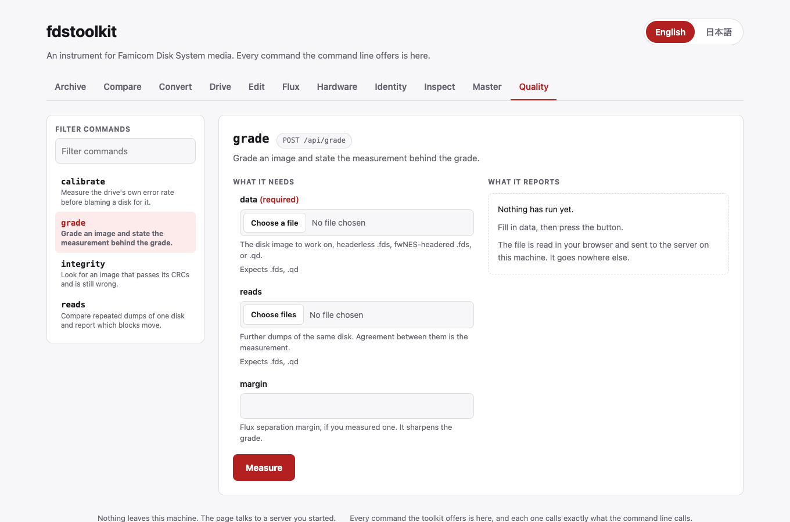

<div align="center">

# fdstoolkit

<strong>讀取 Famicom Disk System 磁碟，評估讀到的內容，還原任天堂寫入的資料，再把它寫回去。</strong>

[English](README.md) | [日本語](README.ja.md) | [简体中文](README.zh-Hans.md) | 繁體中文 (香港)

[](https://github.com/gufranco/fdstoolkit/actions/workflows/ci.yml)
[](https://github.com/gufranco/fdstoolkit/releases/latest)
[](https://github.com/gufranco/fdstoolkit/actions/workflows/ci.yml)
[](https://scorecard.dev/viewer/?uri=github.com/gufranco/fdstoolkit)
[](LICENSE)

<p align="center">
  <a href="#用法">用法</a> |
  <a href="#安裝">安裝</a> |
  <a href="#指令">指令</a> |
  <a href="#操作程序">操作程序</a> |
  <a href="#網頁介面">網頁介面</a> |
  <a href="REFERENCE.md">參考文件</a>
</p>

</div>

共 26 個指令，除 `doctor` 外都可以在本機網頁上使用；1,817 個 Python 測試和 142 個網頁測試覆蓋了 100% 的程式碼行和分支。

---

一套處理 Famicom Disk System 磁碟的命令列工具：讀取、評估、還原、寫回，並讓完成這些工作的磁碟機保持在正確的調校狀態。

它是一件量度儀器，而不是一個應用程式。它假定你知道磁碟資訊區塊是甚麼，願意打開磁碟機去扭微調電位器，並且寧願看到量度數值而不是結論。所有輸出報告的指令都接受 `--json`。沒有失敗時結束碼為 0，有失敗時為 1，因此可以組合到腳本之中。

## 用法

所有處理映像檔的指令都不需要磁碟機。產生校準碟，查看它的內容，檢查它，再識別它：

```bash
fdstoolkit blank --calibration -o calibration.fds
fdstoolkit info calibration.fds
fdstoolkit verify calibration.fds
fdstoolkit hash calibration.fds --profile release
```

```
wrote calibration.fds (131000 bytes)
write it only on a drive you trust, with write --calibration --trusted-drive, which lists every adjustment that drive needs first
calibration.fds: fds container, 2 side(s), 131000 bytes
  side 0: CAL files=6 hidden=0 rewrites=0
  side 1: CAL files=6 hidden=0 rewrites=0
ok
size      131000
crc32     a53e8978
md5       4a73ce2d23e89c68b1b09c280d5eaa11
sha1      9311d8eff476053549e62cff9035bf319998110f
sha256    e2a0bf3ff01a55ddacdbe4a5f62560dc76f12aac5cbf920f5a6f007275e32c02
canonical fdstoolkit:v1:release/v1:466fb0140c92458a0d5e48a08d6574fd0912d45263b1b53d985f348eafcbe0ce
ra md5    4a73ce2d23e89c68b1b09c280d5eaa11
```

`canonical` 這一行是同一發行版的兩張磁碟共有的摘要，即使其中一張曾被 Disk Writer 改寫機重寫也一樣。接上 FDSStick 後，`dump`、`write` 和 `calibrate` 可以處理真實的磁碟，下面的[操作程序](#操作程序)列出了使用次序。

## 安裝

```bash
brew install gufranco/tap/fdstoolkit
```

formula 放在 [gufranco/homebrew-tap](https://github.com/gufranco/homebrew-tap)，這是一個只存放 formula 的共用 tap。`brew install --HEAD gufranco/tap/fdstoolkit` 會追蹤 `main` 分支。

Homebrew 是正式支援的安裝方式，formula 已包含所需的一切：磁碟機需要的 hidapi 程式庫，以及網頁介面。無需另外安裝任何東西，全新安裝後由 `doctor` 證明這一點。

確認安裝結果以及可以連接的硬件：

```bash
fdstoolkit doctor
```

```
fdstoolkit        3.0.0
python            3.14.10
platform          Darwin arm64
hardware support  hidapi is installed
fdsstick          1 device(s) connected, FDSStick, serial 0001, firmware 3.12
fdsstick access   the device opens for reading and writing
codec             a known disk round-trips to the same 65500 bytes, 2 blocks, 0 finding(s)
identity          2 blanks match their published digests
```

`doctor` 檢查整條鏈路，而不只是軟件。它報告 hidapi 是否已安裝，FDSStick 是否連接在 `16D0:0AAA`，裝置自行報告的製造商、產品名稱、序號和韌體版本，以及裝置能否真正開啟。最後一項在 Linux 上最重要：裝置可以被列舉，卻可能因為缺少 udev 規則而無法開啟；這時 `doctor` 會判定該項失敗，並列印需要安裝的規則。

## 指令

每個指令的選項、輸出以及各項數據的依據都在 [REFERENCE.md](REFERENCE.md) 之中，參考文件提供英文版和日文版。任何指令加上 `--help` 都會列印其簡介。

- **查看**：[`info`](REFERENCE.md#info)、[`boot`](REFERENCE.md#boot)、[`hash`](REFERENCE.md#hash)、[`provenance`](REFERENCE.md#provenance)
- **檢查**：[`verify`](REFERENCE.md#verify)、[`grade`](REFERENCE.md#grade)、[`reads`](REFERENCE.md#reads)、[`log`](REFERENCE.md#log)、[`diff`](REFERENCE.md#diff)
- **修復**：[`rebuild`](REFERENCE.md#rebuild)、[`set`](REFERENCE.md#set)、[`insert`](REFERENCE.md#insert)、[`extract`](REFERENCE.md#extract)、[`patch`](REFERENCE.md#patch)、[`splice`](REFERENCE.md#splice)、[`consensus`](REFERENCE.md#consensus)、[`save`](REFERENCE.md#save)
- **容器**：[`convert`](REFERENCE.md#convert)、[`blank`](REFERENCE.md#blank)、[`build`](REFERENCE.md#build)
- **硬件**：[`status`](REFERENCE.md#status)、[`doctor`](REFERENCE.md#doctor)、[`dump`](REFERENCE.md#dump)、[`rescue`](REFERENCE.md#rescue)、[`write`](REFERENCE.md#write)、[`surface`](REFERENCE.md#surface)、[`calibrate`](REFERENCE.md#calibrate)、[`session`](REFERENCE.md#session)、[`web`](REFERENCE.md#web)

## 操作程序

### 保存一張磁碟

一次轉存只說明磁碟機讀到了甚麼。兩次轉存才能說明它是否兩次都讀到相同的內容。按照 [dumping.guide](https://dumping.guide/other/nintendo/fds) 的建議，在第一次轉存前清潔磁碟，第二次轉存前再清潔一次，以免把兩次之間移動了的灰塵誤當成碟面變弱。

```bash
fdstoolkit dump -o pass1.fds --passes 3 --raw captures/
fdstoolkit dump -o pass2.fds
fdstoolkit reads pass1.fds pass2.fds
fdstoolkit reads --captures captures/
fdstoolkit grade pass1.fds --read pass2.fds --captures captures/
```

三遍讀取讓擷取包內每一面都有三次讀取，弱區塊分佈圖和脈衝投票需要的正是這些。如果兩次轉存不一致，`consensus` 會按多數合併，並列出每個未有定論的區塊；`consensus pass1.fds pass2.fds --captures captures/` 會把脈衝投票作為另一個投票者加入。如果某次轉存中損壞的區塊在另一次是完好的，`splice` 會把它取過來。請把擷取包和映像檔放在一起保存：它是磁碟讀取情況的唯一紀錄，日後不需要磁碟也能重新投票。一直讀取失敗的磁碟用 `fdstoolkit rescue rescue-folder/ -o disk.fds`，在之後的日子或其他磁碟機上反覆執行，直到所有區塊都確定：每次執行的讀取都會保存，並與之前的讀取一起投票。

### 校準磁碟機，先粗調後微調

1. 先清潔磁頭。污垢讀起來就像媒體故障。
2. 準備一張原廠磁碟，或一張在你信任的磁碟機上寫入的校準碟。絕不要使用這部磁碟機自己寫入的磁碟。有原廠磁碟的映像檔會令計數更準確；沒有映像檔時，`calibrate` 會從讀取正確的結果中學習每個區塊。
3. 更換皮帶後，執行 `calibrate head`，先調主軸轂，再調磁頭，每次大約轉 45 度，直至每次讀取都正確。
4. 執行 `calibrate speed`，按它的提示調高或調低馬達轉速，直至讀取正確。
5. 轉速的最後微調要用主機上的測試或頻閃儀完成，因為 FDSStick 看不到最後那百分之一。
6. 再用兩張原廠磁碟重複 `calibrate head`。然後用一張公認難讀的磁碟確認：社群慣例使用某個包含 39 個檔案的特定碟面，39 個檔案全部讀出而且沒有校驗和錯誤即為通過。
7. 磁碟機讀取無誤之後，用那張原廠磁碟執行 `fdstoolkit session --reference factory.fds`，記錄一個基準。以後每次開始工作都執行同一條指令：磁碟機讀這張磁碟比上次檢查時差，它就會發出警告。

### 判斷是磁碟機還是磁碟的問題

一張磁碟回答不了這個問題。讀取幾張磁碟並比較失敗的位置：每張磁碟都在同一處失敗，是磁碟機的問題；失敗只出現在一張磁碟上，是那張磁碟的問題；磁碟機不再回應，則兩者都不是。最後一種情況的正確做法是停下來，而不是再放另一張磁碟進去試。

### 檢查 DupliFDS 複製的磁碟

[DupliFDS](https://github.com/ClusterM/duplifds) 直接在主機上複製磁碟，從不讀回寫入的內容，所以複本在與原碟比較之前都未經驗證。

1. 轉存原碟：`fdstoolkit dump -o source.fds`。
2. 轉存複本：`fdstoolkit dump -o copy.fds`。
3. 比較兩者：`fdstoolkit diff source.fds copy.fds --explain`。完全一致表示複本包含每一個區塊。DupliFDS 未完成的複本會被報告為中途停止，並指出它包含原碟中的多少個檔案，因為 DupliFDS 寫入的檔案數目只計算到當時為止已複製的檔案。
4. 評估複本：配合複本的第二次轉存執行 `fdstoolkit grade copy.fds --read copy2.fds`，可以知道新磁碟能否穩定讀取，這一點單憑 `diff` 一致是看不出來的。

## 網頁介面

```bash
fdstoolkit web
```

`web` 會在瀏覽器中開啟頁面。`fdstoolkit web --no-open` 只啟動伺服器而不開啟瀏覽器，經 SSH 使用時就用這個。沒有只限無介面執行的指令，因為本工具驅動的是連接在這部電腦上的硬件，從來不是公共服務。

<picture>
<source media="(prefers-color-scheme: dark)" srcset="assets/screenshots/grade-dark.png">

</picture>

頁面預設綁定 `127.0.0.1:8000`。它不是一項服務：除非傳入 `--host`，否則不會在公共網絡介面上監聽，頁面也不載入任何遠端資源，因此沒有任何資料離開這部電腦。

頁面呼叫的每個路由以及它對應的指令都列在 [REFERENCE.md](REFERENCE.md#web-interface) 之中。

## 本工具做不到的事

**不存在 FDS 的磁通擷取。** Quick Disk 是一條連續的螺旋，沒有索引孔，也沒有標準的步進，因此 KryoFlux 和 Greaseweazle 完全無法讀取這種媒體。本工具只讀取 FDSStick 產生的資料。

**FDSStick 無法從脈衝類別量度出磁碟機轉速的最後百分之一。** 現時的韌體在裝置內把每個脈衝歸入三種長度之一，傳送的是類別而不是時序，所以細微的轉速誤差不會改變任何類別。`calibrate speed` 能找出超出容差的磁碟機，最後的調整由主機上的測試或頻閃儀完成。

**磁頭的精細對準無法從脈衝類別量度。** 這需要訊號幅度或脈衝時序，而韌體 3.12 兩者都不傳送。`calibrate head` 只看到區塊是否讀出，所以它能發現位置偏離的磁頭或主軸轂，卻發現不了只是稍為偏離中心的情況。

**皮帶故障和馬達故障無法區分**，因為這需要皮帶輪的傳動比，而沒有可靠的來源給出這個數值。

## 版本

發佈遵循[語義化版本](https://semver.org/)，每次修正或新增功能都會從 `main` 自動發佈。主版本號升級表示刪除或更改了某個指令，例如 3.0.0 刪除了 `export`。每個版本的說明見[發佈頁面](https://github.com/gufranco/fdstoolkit/releases)。

## 支援

| 需要 | 去處 |
|:-----|:------|
| 有東西運作不正常 | [問題報告](https://github.com/gufranco/fdstoolkit/issues/new?template=bug.yml) |
| 真實磁碟機上的結果 | [硬件報告](https://github.com/gufranco/fdstoolkit/issues/new?template=hardware.yml) |
| 可能的保安問題 | [保安政策](SECURITY.md) |
| 開發環境、測試和發佈 | [CONTRIBUTING.md](CONTRIBUTING.md) |

## 授權

MIT。見 [LICENSE](LICENSE)。

---

<div align="center">

Famicom Disk System / FC 磁碟機 / 磁碟卡 的保存、轉存、磁碟品質量度、
磁碟機校準、皮帶更換、FDSStick。

English documentation: <a href="README.md">README.md</a>

</div>
