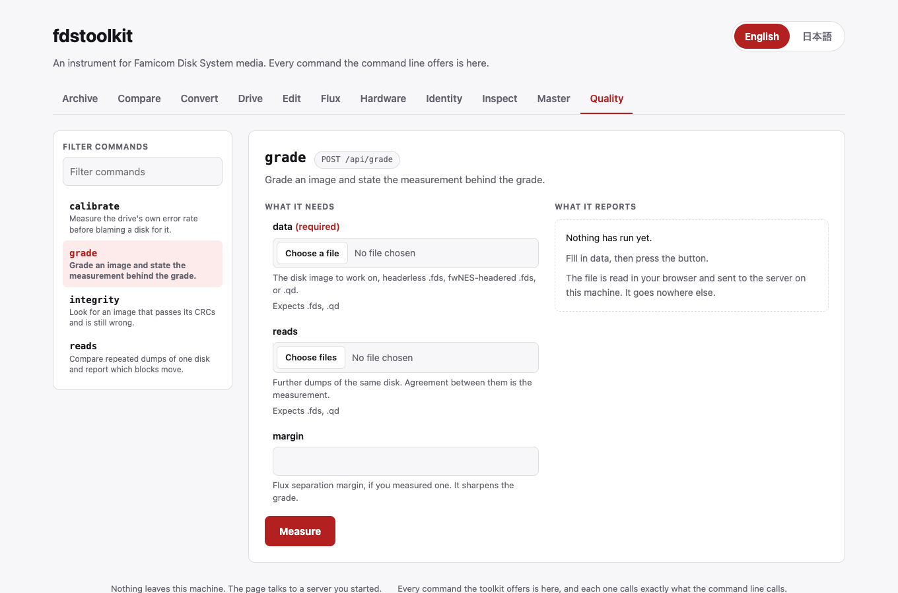

<div align="center">

# fdstoolkit

<strong>读取 Famicom Disk System 磁盘，评估读到的内容，还原任天堂写入的数据，再把它写回去。</strong>

[English](README.md) | [日本語](README.ja.md) | 简体中文 | [繁體中文 (香港)](README.zh-HK.md)

[](https://github.com/gufranco/fdstoolkit/actions/workflows/ci.yml)
[](https://github.com/gufranco/fdstoolkit/releases/latest)
[](https://github.com/gufranco/fdstoolkit/actions/workflows/ci.yml)
[](https://scorecard.dev/viewer/?uri=github.com/gufranco/fdstoolkit)
[](LICENSE)

<p align="center">
  <a href="#用法">用法</a> |
  <a href="#安装">安装</a> |
  <a href="#命令">命令</a> |
  <a href="#操作流程">操作流程</a> |
  <a href="#网页界面">网页界面</a> |
  <a href="REFERENCE.md">参考文档</a>
</p>

</div>

共 26 个命令，除 `doctor` 外都能在本地网页上使用；1,817 个 Python 测试和 142 个网页测试覆盖了 100% 的代码行和分支。

---

一个处理 Famicom Disk System 磁盘的命令行工具包：读取、评估、还原、写回，并让完成这些工作的驱动器保持在正确的调校状态。

它是一件测量仪器，而不是一个应用程序。它假定你知道磁盘信息块是什么，愿意打开驱动器去拧微调电位器，并且宁愿看到测量值而不是结论。所有输出报告的命令都接受 `--json`。没有失败时退出码为 0，有失败时为 1，因此可以组合进脚本。

## 用法

所有处理镜像的命令都不需要驱动器。生成校准盘，查看它的内容，检查它，再识别它：

```bash
fdstoolkit blank --calibration -o calibration.fds
fdstoolkit info calibration.fds
fdstoolkit verify calibration.fds
fdstoolkit hash calibration.fds --profile release
```

```
wrote calibration.fds (131000 bytes)
write it only on a drive you trust, with write --calibration --trusted-drive, which lists every adjustment that drive needs first
calibration.fds: fds container, 2 side(s), 131000 bytes
  side 0: CAL files=6 hidden=0 rewrites=0
  side 1: CAL files=6 hidden=0 rewrites=0
ok
size      131000
crc32     a53e8978
md5       4a73ce2d23e89c68b1b09c280d5eaa11
sha1      9311d8eff476053549e62cff9035bf319998110f
sha256    e2a0bf3ff01a55ddacdbe4a5f62560dc76f12aac5cbf920f5a6f007275e32c02
canonical fdstoolkit:v1:release/v1:466fb0140c92458a0d5e48a08d6574fd0912d45263b1b53d985f348eafcbe0ce
ra md5    4a73ce2d23e89c68b1b09c280d5eaa11
```

`canonical` 这一行是同一发行版的两张磁盘共有的摘要，即使其中一张被 Disk Writer 改写机重写过也一样。接上 FDSStick 后，`dump`、`write` 和 `calibrate` 可以处理真实的磁盘，下面的[操作流程](#操作流程)给出了使用顺序。

## 安装

```bash
brew install gufranco/tap/fdstoolkit
```

formula 位于 [gufranco/homebrew-tap](https://github.com/gufranco/homebrew-tap)，这是一个只放 formula 的共享 tap。`brew install --HEAD gufranco/tap/fdstoolkit` 跟踪 `main` 分支。

Homebrew 是官方支持的安装方式，formula 包含了所需的一切：驱动器需要的 hidapi 库，以及网页界面。无需另外安装任何东西，全新安装后由 `doctor` 来证明这一点。

确认安装结果以及能连接到的硬件：

```bash
fdstoolkit doctor
```

```
fdstoolkit        3.0.0
python            3.14.10
platform          Darwin arm64
hardware support  hidapi is installed
fdsstick          1 device(s) connected, FDSStick, serial 0001, firmware 3.12
fdsstick access   the device opens for reading and writing
codec             a known disk round-trips to the same 65500 bytes, 2 blocks, 0 finding(s)
identity          2 blanks match their published digests
```

`doctor` 检查整条链路，而不只是软件。它报告 hidapi 是否已安装，FDSStick 是否连接在 `16D0:0AAA`，设备自报的制造商、产品名、序列号和固件版本，以及设备能否真正打开。最后一项在 Linux 上最重要：设备能被枚举，却可能因为缺少 udev 规则而无法打开；这时 `doctor` 会判定该项失败，并打印需要安装的规则。

## 命令

每个命令的选项、输出以及各项数据的依据都在 [REFERENCE.md](REFERENCE.md) 中，参考文档提供英文版和日文版。任何命令加上 `--help` 都会打印其简介。

- **查看**：[`info`](REFERENCE.md#info)、[`boot`](REFERENCE.md#boot)、[`hash`](REFERENCE.md#hash)、[`provenance`](REFERENCE.md#provenance)
- **检查**：[`verify`](REFERENCE.md#verify)、[`grade`](REFERENCE.md#grade)、[`reads`](REFERENCE.md#reads)、[`log`](REFERENCE.md#log)、[`track`](REFERENCE.md#track)、[`triage`](REFERENCE.md#triage)、[`diff`](REFERENCE.md#diff)
- **修复**：[`rebuild`](REFERENCE.md#rebuild)、[`set`](REFERENCE.md#set)、[`insert`](REFERENCE.md#insert)、[`extract`](REFERENCE.md#extract)、[`patch`](REFERENCE.md#patch)、[`splice`](REFERENCE.md#splice)、[`consensus`](REFERENCE.md#consensus)、[`save`](REFERENCE.md#save)
- **容器**：[`convert`](REFERENCE.md#convert)、[`blank`](REFERENCE.md#blank)、[`build`](REFERENCE.md#build)
- **硬件**：[`status`](REFERENCE.md#status)、[`doctor`](REFERENCE.md#doctor)、[`dump`](REFERENCE.md#dump)、[`rescue`](REFERENCE.md#rescue)、[`erase`](REFERENCE.md#erase)、[`write`](REFERENCE.md#write)、[`duplicate`](REFERENCE.md#duplicate)、[`surface`](REFERENCE.md#surface)、[`calibrate`](REFERENCE.md#calibrate)、[`session`](REFERENCE.md#session)、[`web`](REFERENCE.md#web)

## 操作流程

### 保存一张磁盘

一次转储只说明驱动器读到了什么。两次转储才能说明它是否两次读到了相同的内容。按照 [dumping.guide](https://dumping.guide/other/nintendo/fds) 的建议，在第一次转储前清洁磁盘，第二次转储前再清洁一次，以免把两次之间移动的灰尘误判为盘面变弱。

```bash
fdstoolkit dump -o pass1.fds --passes 3 --raw captures/
fdstoolkit dump -o pass2.fds
fdstoolkit reads pass1.fds pass2.fds
fdstoolkit reads --captures captures/
fdstoolkit grade pass1.fds --read pass2.fds --captures captures/
```

三遍读取让采集包里每一面都有三次读取，弱块分布图和脉冲投票需要的正是这些。如果两次转储不一致，`consensus` 按多数合并它们，并列出每个没有定论的块；`consensus pass1.fds pass2.fds --captures captures/` 会把脉冲投票作为又一个投票者加入。如果某次转储里坏掉的块在另一次里是好的，`splice` 会把它取过来。请把采集包和镜像放在一起保存：它是磁盘读取情况的唯一记录，以后不需要磁盘也能重新投票。一直读取失败的磁盘用 `fdstoolkit rescue rescue-folder/ -o disk.fds`，在之后的日子或其他驱动器上反复运行，直到所有块都确定：每次运行的读取都会保存，并与之前的读取一起投票。

### 校准驱动器，先粗调后细调

1. 先清洁磁头。污垢读起来就像介质故障。
2. 准备一张原厂磁盘，或者一张在你信任的驱动器上写入的校准盘。绝不要使用这台驱动器自己写入的磁盘。有原厂磁盘的镜像会让计数更准确；没有镜像时，`calibrate` 会从读取正确的结果中学习每个块。
3. 更换皮带后，运行 `calibrate head`，先调主轴毂，再调磁头，每次大约转 45 度，直到每次读取都正确。
4. 运行 `calibrate speed`，按它的提示调高或调低电机转速，直到读取正确。
5. 转速的最后微调要用主机上的测试或频闪仪完成，因为 FDSStick 看不到最后那百分之一。
6. 再用两张原厂磁盘重复 `calibrate head`。然后用一张公认难读的磁盘确认：社区惯例使用某个包含 39 个文件的特定盘面，39 个文件全部读出且没有校验和错误即为通过。
7. 驱动器读取无误之后，用那张原厂磁盘运行 `fdstoolkit session --reference factory.fds`，记录一个基准。以后每次开始工作都运行同一条命令：驱动器读这张磁盘比上次检查时差，它就会发出警告。

### 判断是驱动器的问题还是磁盘的问题

一张磁盘回答不了这个问题。读取几张磁盘并比较失败的位置：每张磁盘都在同一处失败，是驱动器的问题；失败只出现在一张磁盘上，是那张磁盘的问题；驱动器不再响应，则两者都不是。最后一种情况的正确做法是停下来，而不是再放一张磁盘进去试。`fdstoolkit triage a/ b/ c/` 用同一台驱动器对每张磁盘执行 `dump --raw` 所保存的采集包来做这个比较。

### 检查 DupliFDS 拷贝的磁盘

[DupliFDS](https://github.com/ClusterM/duplifds) 在主机上直接复制磁盘，从不读回写入的内容，所以拷贝在与原盘比较之前都未经验证。

1. 转储原盘：`fdstoolkit dump -o source.fds`。
2. 转储拷贝：`fdstoolkit dump -o copy.fds`。
3. 比较两者：`fdstoolkit diff source.fds copy.fds --explain`。完全一致说明拷贝包含每一个块。DupliFDS 没有完成的拷贝会被报告为中途停止，并指出它包含原盘中的多少个文件，因为 DupliFDS 写入的文件数只统计到当时为止已复制的文件。
4. 评估拷贝：配合拷贝的第二次转储运行 `fdstoolkit grade copy.fds --read copy2.fds`，可以知道新磁盘能否稳定读取，这一点仅凭 `diff` 一致是看不出来的。

### 制作多份拷贝

`fdstoolkit duplicate source.fds --count 5` 依次要求放入每张空白磁盘，写入镜像，读回拷贝，并为每份拷贝打印一行。失败的拷贝会连同原因一起计数，然后继续下一张磁盘。分发之前，请在另一台驱动器上读取每份拷贝：驱动器能读回自己写的内容，并不能说明这台驱动器没有问题。

## 网页界面

```bash
fdstoolkit web
```

`web` 会在浏览器中打开页面。`fdstoolkit web --no-open` 只启动服务器而不打开浏览器，通过 SSH 使用时就用这个。没有仅限无界面运行的命令，因为本工具驱动的是连接在这台机器上的硬件，从来不是公共服务。

<picture>
<source media="(prefers-color-scheme: dark)" srcset="assets/screenshots/grade-dark.png">

</picture>

页面默认绑定 `127.0.0.1:8000`。它不是一项服务：除非传入 `--host`，否则不会在公共网络接口上监听，页面也不加载任何远程资源，因此没有任何数据离开这台机器。

页面调用的每个路由以及它对应的命令都列在 [REFERENCE.md](REFERENCE.md#web-interface) 中。

## 本工具做不到的事

**不存在 FDS 的磁通采集。** Quick Disk 是一条连续的螺旋，没有索引孔，也没有标准的步进，因此 KryoFlux 和 Greaseweazle 完全无法读取这种介质。本工具只读取 FDSStick 产生的数据。

**FDSStick 无法从脉冲类别中测出驱动器转速的最后百分之一。** 当前固件在设备内把每个脉冲归入三种长度之一，发送的是类别而不是时序，所以微小的转速误差不会改变任何类别。`calibrate speed` 能找出超出容差的驱动器，最后的调整由主机上的测试或频闪仪完成。

**磁头的精细对准无法从脉冲类别中测量。** 这需要信号幅度或脉冲时序，而固件 3.12 两者都不发送。`calibrate head` 只能看到块是否读出，所以它能发现位置偏离的磁头或主轴毂，却发现不了只是稍微偏离中心的情况。

**皮带故障和电机故障无法区分**，因为这需要皮带轮的传动比，而没有可靠的来源给出这个数值。

## 版本

发布遵循[语义化版本](https://semver.org/)，每次修复或新增功能都会从 `main` 自动发布。主版本号升级意味着删除或更改了某个命令，例如 3.0.0 删除了 `export`。每个版本的说明见[发布页面](https://github.com/gufranco/fdstoolkit/releases)。

## 支持

| 需要 | 去处 |
|:-----|:------|
| 有东西不正常 | [问题报告](https://github.com/gufranco/fdstoolkit/issues/new?template=bug.yml) |
| 真实驱动器上的结果 | [硬件报告](https://github.com/gufranco/fdstoolkit/issues/new?template=hardware.yml) |
| 可能的安全问题 | [安全策略](SECURITY.md) |
| 开发环境、测试和发布 | [CONTRIBUTING.md](CONTRIBUTING.md) |

## 许可证

MIT。见 [LICENSE](LICENSE)。

---

<div align="center">

Famicom Disk System / FC 磁碟机 / 磁盘卡 的保存、转储、磁盘质量测量、
驱动器校准、皮带更换、FDSStick。

English documentation: <a href="README.md">README.md</a>

</div>
